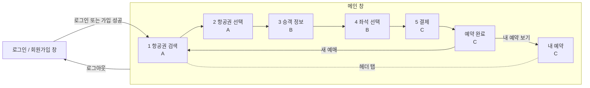

# 구조와 페이지 연결 (팀 공용 설명서)

이 문서는 세 명(A, B, C)과 각자의 AI가 **같은 그림을 보고** 작업하기 위한 설명서입니다.
페이지를 만들기 전에 1~5절은 꼭 읽으세요.

## 1. 용어

| 화면에서 부르는 말 | 코드 | 뜻 |
| --- | --- | --- |
| 항공권 | `Flight` (`DomesticFlight`, `InternationalFlight`) | 특정 날짜·시각의 비행 1편. 예) 11/13 12:10 김포→제주 HS1205 |
| 여정 | `Itinerary`, `TripType` | 편도(가는 편) 또는 왕복(가는 편 + 오는 편) + 좌석 등급 |
| 구간 | `SegmentType` (`OUTBOUND` 가는 편, `INBOUND` 오는 편) | 좌석·수하물·체크인은 구간마다 따로 |
| e-티켓 | `Ticket` | 승객 1명의 1구간 발권 내역 (왕복 2명 = 4장) |
| 예약 | `Booking`, `BookingSegment` | 예약번호 하나에 여정, 승객, 구간별 e-티켓, 결제가 묶인 것 |
| 세션 | `BookingSession` | 예매 중인 정보를 페이지끼리 넘기는 바구니 |
| 회원 | `User`, `AuthService` | 아이디·비밀번호(해시 저장) |

화면 문구는 **"항공권"으로 통일**합니다. ("항공편"이라고 쓰지 않습니다.)

## 2. 전체 흐름



- 프로그램을 켜면 **로그인/회원가입 창**이 먼저 뜹니다. 회원가입에 성공하면 그대로 로그인되어 메인 창으로 들어갑니다.
- 메인 창 헤더: `[항공권 예매] [내 예약]` 탭 · 현재 시각 · `[시각 이동]`(시연용) · `아이디 님` · `[로그아웃]`
- 로그아웃하면 메인 창이 닫히고 로그인 창이 다시 뜹니다. 진행 중이던 예매 정보는 버립니다.
- 3~5단계 페이지 위쪽에는 **선택한 항공권 요약 바**(`TicketSummaryBar`)가 자동으로 붙습니다. 페이지 담당자가 만들 필요가 없습니다.

## 3. 패키지와 담당

```
src/airline
├─ app/            Main, AppFactory(객체 조립), SampleData(노선·시간표·시연 계정)        공용
├─ domain/
│  ├─ user/        User, PasswordHasher                                              공용
│  ├─ flight/      Flight(추상) ← Domestic/International, Route, Airport, AircraftType, TimeBand
│  ├─ seat/        Seat(추상) ← Economy/ExitRow/Business, CabinClass
│  ├─ passenger/   Passenger(추상) ← Adult/Child/Infant, PassengerFactory, Gender, AgeCalculator
│  └─ booking/     Itinerary, TripType, SegmentType, Booking, BookingSegment, Ticket, PriceBreakdown, CancellationQuote
├─ policy/         취소·수하물 규정 (인터페이스 + 국내선/국제선 구현)                      공용
├─ payment/        PaymentMethod ← AbstractPayment ← CreditCard/BankTransfer/Simple, PaymentFormats
├─ repository/     저장소 인터페이스 + 메모리 구현 (회원, 항공권, 예약)                    공용
├─ service/        AuthService, FlightSearchService, BookingService, SearchCriteria, SearchResult, BookingRequest, AppServices
├─ exception/      AirlineException(부모) ← 상황별 예외 (각자 알림창 제목이 다름)           공용
├─ util/           AppClock(현재 시각의 유일한 창구), Formats(날짜·금액 표시)             공용
├─ dev/            PageLauncher, SessionFixtures, ContextPack (개발 도구)                공용
└─ ui/
   ├─ Application, MainFrame, AppContext, BasePanel, BookingSession, Screen,
   │  PageRegistry, PageOwner, UiTheme                                               공용
   ├─ login/       LoginFrame                                                        공용
   ├─ common/      TicketSummaryBar                                                  공용
   └─ page/
      ├─ search/     SearchPage, FlightSelectPage                                    ★ A
      ├─ passenger/  PassengerPage, SeatPage                                         ★ B
      └─ payment/    PaymentPage, ConfirmationPage, MyBookingsPage                   ★ C
test/airline
├─ CoreTest, PageSmokeTest, TestSupport, TestWorld, HeadlessAppContext, AllTests     공용
├─ SearchTest                                                                        ★ A
├─ PassengerSeatTest                                                                 ★ B
└─ PaymentBookingTest                                                                ★ C
```

**의존 방향**: `ui.page.*` → `ui`(공용 틀) → `service` → `domain` / `policy` / `payment` → `exception`, `util`
- 페이지는 서로를 모릅니다 (A의 클래스가 B의 클래스를 import하지 않음).
- 서비스와 도메인은 Swing을 모릅니다. 그래서 화면 없이 테스트할 수 있습니다.

**공용 코드 담당(통합 담당)**: 팀에서 한 명을 정합니다 (보통 팀장, 자기 페이지도 맡음).
공용 파일 변경은 통합 담당만 하고, 나머지는 요청서를 보냅니다 → `docs/AI-GUIDE.md` 6번.

## 4. 페이지 계약 (가장 중요)

페이지끼리는 `BookingSession`으로만 데이터를 넘깁니다. 각 페이지는

- **들어올 때**: 앞 페이지가 세션에 채워 둔 값이 있다고 믿고 읽기만 하면 됩니다. (없으면 `MainFrame`이 막아 줍니다)
- **나갈 때**: 다음 페이지의 입장 조건(`Screen.check`)을 만족하도록 세션에 값을 저장하고 `app.navigate(다음)`을 부릅니다.

| 페이지 (`Screen`) | 담당 | 들어올 때 세션에 있는 것 | 나갈 때 해야 할 일 | 다음 |
| --- | --- | --- | --- | --- |
| 항공권 검색 `SEARCH` | A | 없음 | `startSearch(criteria, result)` | `FLIGHT_SELECT` |
| 항공권 선택 `FLIGHT_SELECT` | A | `getCriteria()`, `getSearchResult()` | `selectOutbound(f)` (+왕복이면 `selectInbound(f)`) | `PASSENGER` |
| 승객 정보 `PASSENGER` | B | `requireItinerary()`, `getCriteria().toPassengerTypes()` | `validatePassengers(...)` 통과 후 `setPassengers(list)` | `SEAT` |
| 좌석 선택 `SEAT` | B | 위 + `getPassengers()`, `getSeatedPassengers()` | 모든 구간에 `assignSeat(구간, 승객, 좌석)` → `allSeatsAssigned()` | `PAYMENT` |
| 결제 `PAYMENT` | C | 위 + 구간별 좌석 → `toRequest()` 가능 | `createBooking(...)` 성공 후 `completeBooking(booking)` | `CONFIRMATION` |
| 예약 완료 `CONFIRMATION` | C | `getLastBooking()` | 없음 (`MY_BOOKINGS` 또는 `startNewBooking()`) | - |
| 내 예약 `MY_BOOKINGS` | C | 없음 (`app.getCurrentUser()`) | 없음 | - |

세션의 자동 정리 규칙 (앞 단계를 바꾸면 뒤 단계가 비워짐):
- `startSearch` → 항공권 선택, 승객, 좌석, 수하물 모두 초기화
- `selectOutbound`(다른 항공권) → 가는 편 좌석 초기화, 시간이 안 맞게 된 오는 편 선택 취소
- `selectInbound`(다른 항공권) → 오는 편 좌석 초기화 / 가는 편 도착 1시간 전 출발편이면 예외
- `setPassengers` → 모든 구간 좌석·수하물 초기화
- `completeBooking` → 진행 정보 비우고 `lastBooking`만 남김 (검색 조건은 유지)

## 5. 페이지 만드는 법 (틀)

```java
package airline.ui.page.search;            // 내 패키지

public class SearchPage extends BasePanel {

    public SearchPage(AppContext app) {
        super(app, Screen.SEARCH);          // 제목·부제목·단계 표시줄·요약 바는 BasePanel이 그림
        setContent(본문);                    // 또는 setScrollableContent(긴 본문)
        addBackButton();                    // 하단 왼쪽 [이전] (앞 단계로)
        addFooterButton(다음버튼);            // 하단 오른쪽
    }

    @Override
    protected void onShow() {               // 이 페이지가 보일 때마다 호출
        // session()에서 값을 읽어 화면을 다시 채운다 (알림창 금지)
    }

    private void goNext() {
        try {
            ... 서비스 호출 ...
            session().저장(...);
            app.navigate(Screen.FLIGHT_SELECT);
        } catch (AirlineException e) {
            showError(e);                   // 예외 종류별 제목으로 알림창
        }
    }
}
```

`BasePanel`이 주는 것: `app`(AppContext), `session()`, `setContent`, `setScrollableContent`, `setSubtitle`,
`addFooterButton`, `addBackButton`, `addFooterLeft`, `showError`, `showWarning`, `showInfo`, `confirm`

`AppContext`가 주는 것: `getSearchService()`, `getBookingService()`, `getClock()`, `getSession()`,
`getCurrentUser()`, `navigate(Screen)`, `startNewBooking()`

## 6. 공용 기능 요약 (페이지에서 호출만 하면 되는 것)

| 필요한 것 | 호출 | 주 사용 |
| --- | --- | --- |
| 출발지 목록 / 그 출발지의 도착지만 | `searchService.getOrigins()`, `getDestinations(origin)` | A |
| 달력에서 고를 수 있는 범위 | `getFirstSearchableDate()`, `getLastSearchableDate()` | A |
| 날짜별 최저가 (달력에 표시) | `findLowestAdultPrice(origin, dest, date, cabin)` | A |
| 편도/왕복 검색 | `search(SearchCriteria.oneWay(...)/roundTrip(...))` → `SearchResult` | A |
| 같은 날 왕복 시간 맞는 오는 편 | `result.inboundOptionsFor(outbound)`, `Itinerary.canPair(a, b)` | A |
| 시간대 (오전/오후/저녁) | `flight.getTimeBand()`, `TimeBand` | A |
| 만 나이 계산 (생년월일 8자리) | `AgeCalculator.calculate("19950315", 탑승일)` → 나이, 국내선/국제선 유형 | A, B |
| 승객 만들기 / 검증 | `PassengerFactory.create(...)`, `bookingService.validatePassengers(itinerary, list)` | B |
| 좌석 규칙 검사 / 자동 배정 | `bookingService.checkSeat(...)`, `autoAssignSeats(...)` | B |
| 요금 견적 | `bookingService.quote / quoteSegment / quoteTotal(request)` | C |
| 결제 수단 (형식 검사 포함) | `new CreditCardPayment(...)`, `new BankTransferPayment(...)`, `new SimplePayment(...)` | C |
| 입력 서식 도우미 | `PaymentFormats.formatCardNumber`, `maskCardNumber`, `isLuhnValid`, `digitsOnly` | C |
| 예약 확정 | `bookingService.createBooking(user, request, payment)` | C |
| 내 예약 / 취소 견적 / 취소 / 체크인 | `getMyBookings(user)`, `quoteCancellation`, `cancel`, `checkIn(user, booking, 구간)` | C |

## 7. 요청사항이 어디에 반영되었나

| 요청 | 베이스에서 완료 | 담당이 화면에서 구현 |
| --- | --- | --- |
| 로그인·회원가입(가입 즉시 로그인)·로그아웃 | ✅ `LoginFrame`, `AuthService`, `Application` | - |
| "항공권"으로 용어 통일 | ✅ 공용 코드 전체 | 각 페이지 문구도 "항공권" |
| 편도 + 왕복 | ✅ `TripType`, `Itinerary`, 구간별 좌석·체크인·취소 | A: 왕복 선택 UI, 오는 편 선택 / B: 구간별 좌석 / C: 구간별 표시 |
| 달력으로 날짜 선택 | 범위·최저가 API | **A**: 달력 컴포넌트 |
| 출발지 → 해당 도착지만 | ✅ `getDestinations(origin)` (뼈대에도 적용) | A: 모양 다듬기 |
| 노선·날짜마다 항공권 2~3개 | ✅ `SampleData` (5개 노선 왕복, 30일) | - |
| 승객 정보~결제 상단에 선택 항공권 | ✅ `TicketSummaryBar` 자동 표시 | - |
| 만 나이 계산기 (8자리) | ✅ `AgeCalculator` 규칙 | **A**: 계산기 창 (인원 선택 옆) / B: 생년월일 옆 만 나이 표시 |
| 결제 정보 입력 (카드·계좌) | ✅ 형식 검사·마스킹 (`CreditCardPayment`, `BankTransferPayment`) | **C**: 입력 칸과 수단 전환 |
| 승객 성별 | ✅ `Gender`, `Passenger.getGender()` | **B**: 성별 선택 (뼈대에 기본 콤보 있음) |

## 8. 테스트와 개발 도구

| 도구 | 언제 | 명령 |
| --- | --- | --- |
| 전체 자동 테스트 | 커밋 전에 항상 | `test.bat` / `./test.sh` |
| 페이지 단독 실행 | 내 페이지를 눌러 볼 때 (앞 페이지 없이도) | `page.bat SEAT ROUNDTRIP` |
| AI 자료 묶음 | 채팅형 AI에게 맥락을 줄 때 | `context.bat B` |
| 전체 실행 | 통합 확인, 시연 | `run.bat` (demo / demo1234) |

`page.bat` 데이터 종류: `ONEWAY`(국내선 편도 성인 1), `ROUNDTRIP`(국내선 왕복 성인 2+소아 1),
`INTL`(국제선 편도 성인 1+유아 1), `INTL_ROUNDTRIP`(국제선 왕복 성인 2+소아 1+유아 1)
→ 내 페이지는 **네 가지 데이터 모두**에서 동작해야 합니다. `PageSmokeTest`가 이것을 자동으로 확인합니다.

개발 모드(`page.bat`)에서는 페이지를 이동할 때마다 콘솔에 `[세션 검사] SEAT → PAYMENT : 통과`처럼 찍히고,
헤더의 `[세션 보기]`로 세션 내용을 볼 수 있습니다. "막힘"이 나오면 내 페이지가 세션에 저장할 것을 빠뜨린 것입니다.

## 9. 시연 데이터

- 시연용 계정 `demo` / `demo1234`: 예약 2건 (내일 12:10 김포↔제주 왕복, 10일 뒤 인천→도쿄 유아 동반)
- 노선: 김포↔제주, 김포↔부산, 부산↔제주, 인천↔도쿄, 인천↔방콕 (방향마다 하루 2~3편, 오늘부터 30일)
- 다른 고객이 예약한 것처럼 좌석의 25~75%가 차 있음 (실행할 때마다 같은 배치)
- 결제는 모의 결제입니다. 테스트 카드번호 `4111 1111 1111 1111`, 유효기간은 미래 아무 날짜
- `[시각 이동]`으로 시간을 앞당기면 체크인 가능 시간, 취소 수수료 변화를 시연할 수 있습니다.
- 회원과 예약은 메모리에만 저장되어 프로그램을 끄면 사라집니다. (파일 저장은 저장소 구현만 바꾸면 되는 확장 과제)
