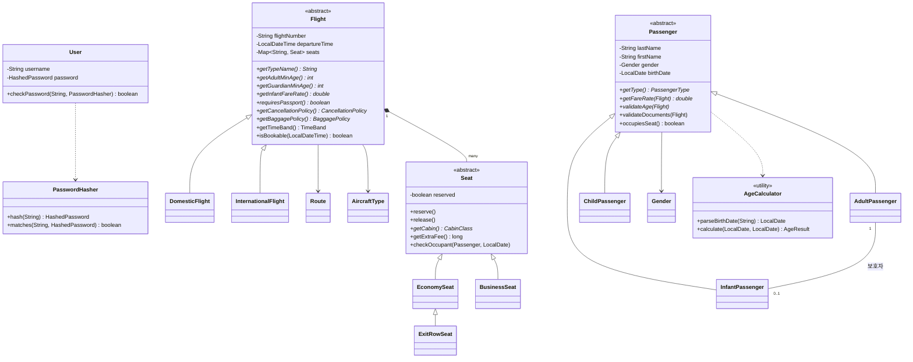
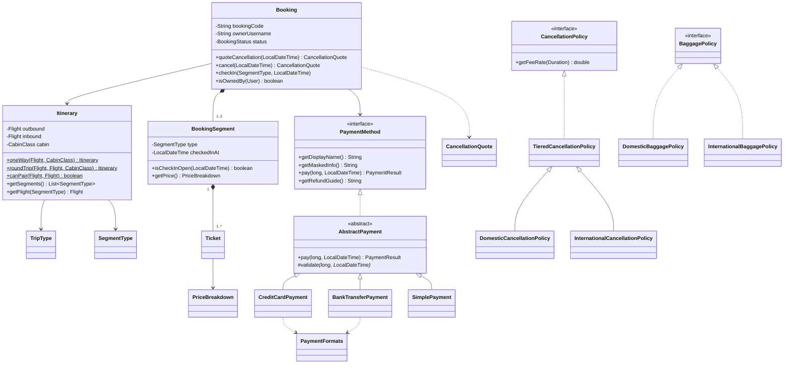
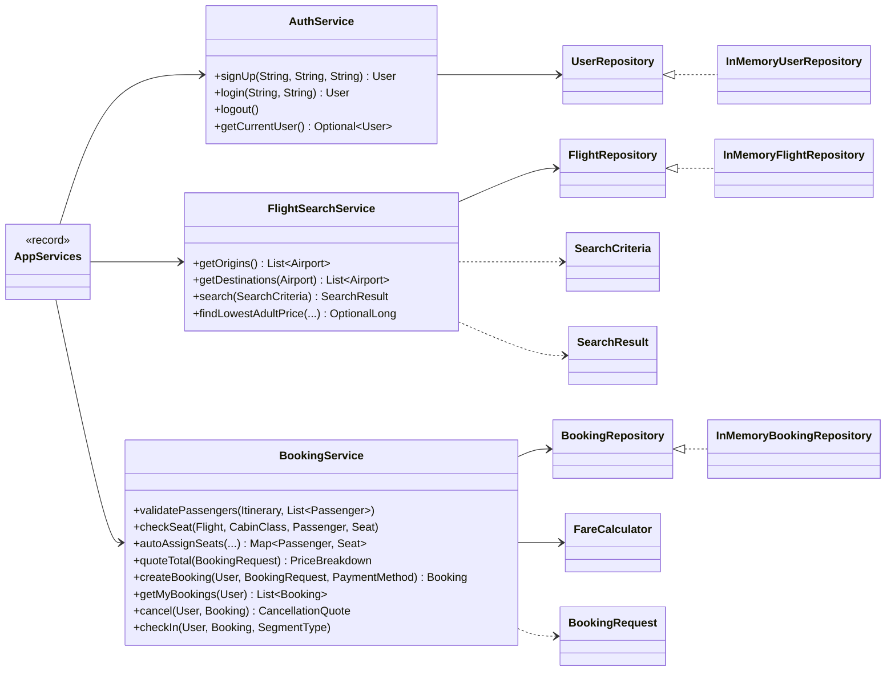
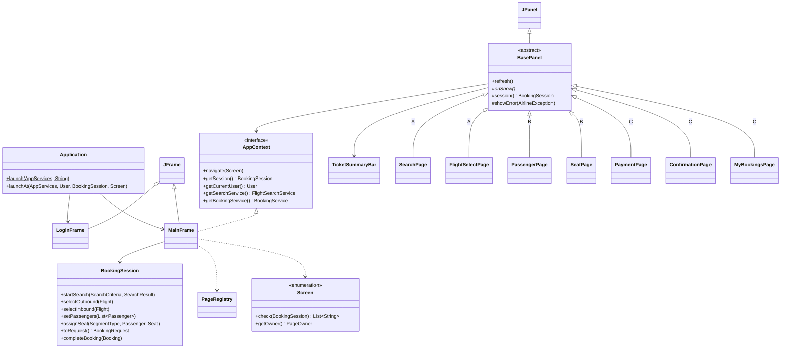

# 클래스 다이어그램 (베이스 설계 v1)

GitHub에서 이 파일을 열면 그림으로 보입니다 (Mermaid).
12주차 SOLID 검토 후 바뀐 구조는 `class-diagram-v2.md`로 따로 남겨 두세요. 초기 설계와 최종 설계 비교가 README와 발표자료의 필수 항목입니다.
페이지 담당자가 자기 폴더에 클래스를 추가하면 4번 그림에 덧붙입니다.

## 1. 회원 · 항공권 · 좌석 · 승객

## 2. 여정 · 예약 · 결제 · 규정

## 3. 서비스 · 저장소

## 4. 화면 (Swing)

